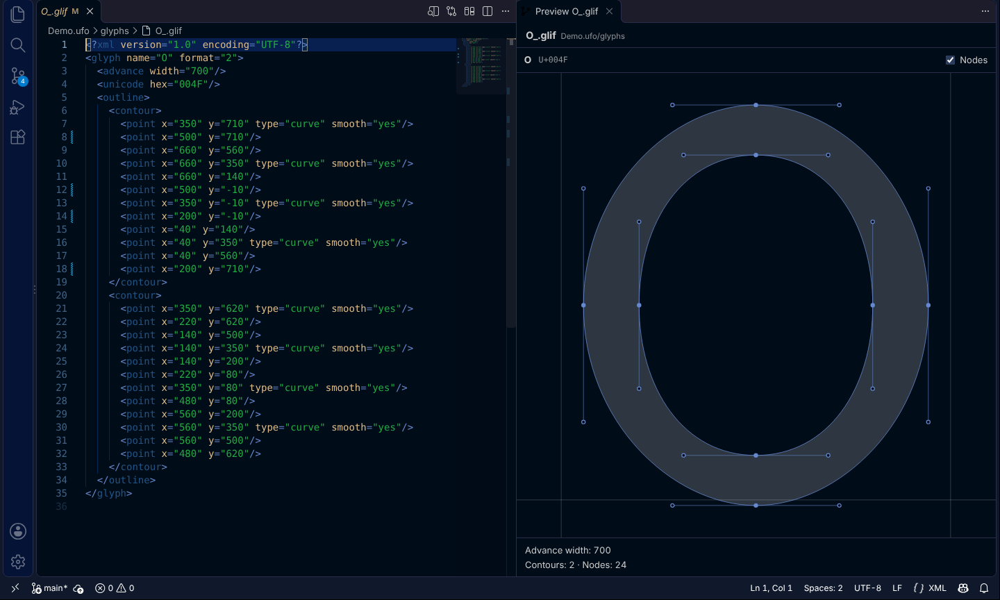
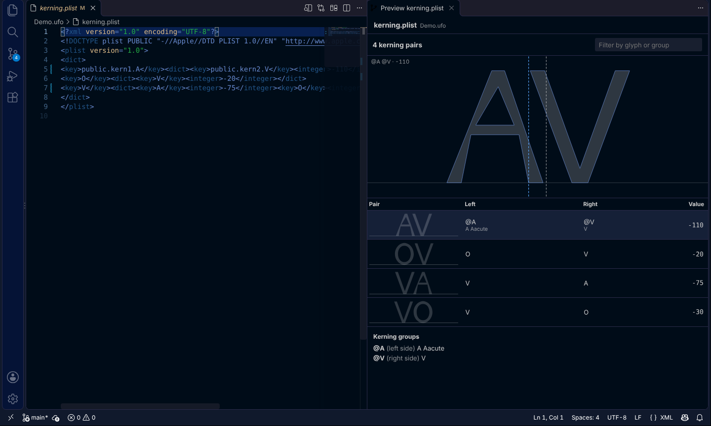
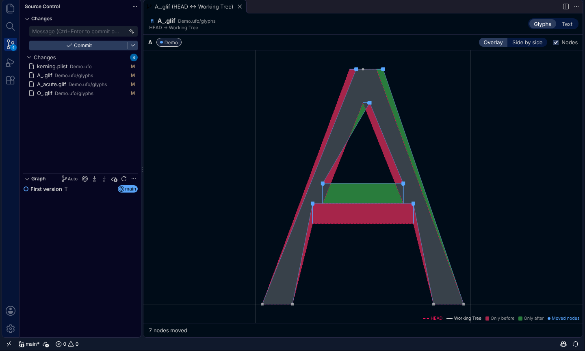
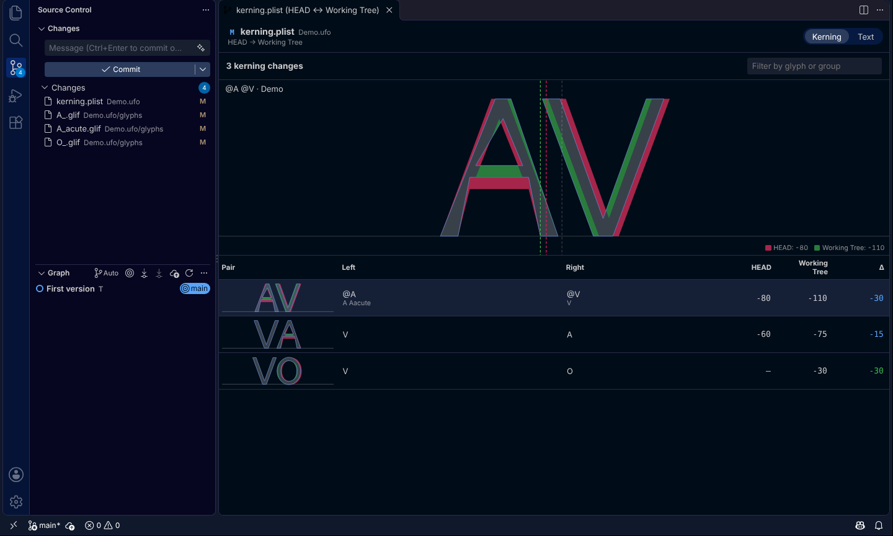

# Fontra Preview for VS Code

A VS Code extension that draws font sources instead of showing them only as XML, JSON or plist text: a preview of the glyph or kerning file you are editing, and its changes as pictures. It uses the drawing code of the [Fontra Source Control](https://github.com/dg4-dev/fontra-source-control) plugin, so diffs look the same in Fontra and in VS Code.

- **Open Preview to the Side**: the glyph (outline, nodes, components, anchors) or the font's kerning pairs, redrawn while you type, also before the file is saved
- **Open Changes as Drawing**: the changes of a glyph or kerning file as a picture
  - Glyphs: the area only the old version covers is red, the area only the new version covers is green and the shared area is gray. Moved nodes are blue. Overlay or side by side
  - Kerning: every changed pair drawn at its old and new spacing, with the values and the difference
  - Every file also has a line diff (Text tab)
- **Open Changes from History…**: pick a commit that changed the file and see what it changed

| Glyph preview                                                                                    | Kerning preview                                                                     |
| ------------------------------------------------------------------------------------------------ | ----------------------------------------------------------------------------------- |
|                  |  |
| **Glyph changes**                                                                                | **Kerning changes**                                                                 |
|  |                  |

## Supported files

| Format                                            | Glyphs                  | Kerning                                       |
| ------------------------------------------------- | ----------------------- | --------------------------------------------- |
| UFO (`.ufo`, also inside `.designspace` projects) | `glyphs*/*.glif`        | `kerning.plist`, `groups.plist`               |
| Fontra (`.fontra`)                                | `glyphs/*.json`         | `kerning.csv`                                 |
| Glyphs (`.glyphs`)                                | every glyph in the file | `kerningLTR` (Glyphs 3), `kerning` (Glyphs 2) |
| Glyphs package (`.glyphspackage`)                 | `glyphs/*.glyph`        | `fontinfo.plist`                              |

Components are drawn by reading their base glyphs from the same font, and kerning pairs by reading the glyphs of the pair. For a kerning group, the first glyph of the group is drawn.

## Install

You need [git](https://git-scm.com/downloads) for the diffs (the preview works without it). Unlike the Fontra plugin, the extension needs no git bridge: VS Code runs git itself.

1. Get `fontra-preview-<version>.vsix`: build it (see [Development](#development)), or download it from the repository's [Releases](https://github.com/dg4-dev/fontra-source-control/releases) when a release has it attached
2. In VS Code, open the Extensions view, choose **⋯ → Install from VSIX…** and pick the file

Or from a terminal:

```plaintext
code --install-extension fontra-preview-0.1.0.vsix
```

## Usage

The commands are in the **Fontra** category of the Command Palette (Ctrl+Shift+P / ⌘⇧P), and in these places:

| Where                                                                                            | Command                                                                       | What it compares                                                                          |
| ------------------------------------------------------------------------------------------------ | ----------------------------------------------------------------------------- | ----------------------------------------------------------------------------------------- |
| Editor title bar of a glyph or kerning file                                                      | Preview button, Changes button                                                | The changes not committed yet: `HEAD` → the editor's text                                 |
| Editor title bar of a diff editor (for example after clicking a file in the Source Control view) | Changes button                                                                | The same two versions as the diff editor                                                  |
| Right-click a file in the **Source Control** view                                                | Open Changes as Drawing                                                       | Staged changes: `HEAD` → index. Changes: index → working tree. Same as VS Code's own diff |
| Right-click a file in the **Explorer** or on an editor tab                                       | Open Preview to the Side, Open Changes as Drawing, Open Changes from History… |                                                                                           |
| Right-click a commit in the **Timeline** view                                                    | Open Changes as Drawing                                                       | The commit before it → the commit                                                         |

Unsaved edits count as the working tree: the diff and the preview show what the editor shows. Open diffs of uncommitted changes redraw when the font's files are edited, saved or staged.

In the drawings:

| Control                | Description                                                                                                                                                        |
| ---------------------- | ------------------------------------------------------------------------------------------------------------------------------------------------------------------ |
| Glyph list             | For files with more than one glyph (`.glyphs`). Type to filter                                                                                                     |
| Layer chips            | One per layer or source (master). In diffs, a dot shows whether the layer was added (green), deleted (red), changed (blue) or not changed (gray)                   |
| Overlay / Side by side | Diffs only. Overlay draws both versions on top of each other; side by side draws the old version on the left and the new one on the right                          |
| Nodes                  | Shows nodes and handles                                                                                                                                            |
| Mouse                  | Wheel to zoom, drag to pan, double-click to fit. The preview keeps its zoom while you type                                                                         |
| Kerning table          | Click a pair to draw it large. In the preview, the gray dashed line is where the right glyph would start without kerning, and the blue one where it starts with it |

## Settings

| Setting                       | Default   | Description                                                             |
| ----------------------------- | --------- | ----------------------------------------------------------------------- |
| `fontraPreview.glyphDiffMode` | `overlay` | `overlay` or `sideBySide`. Also changed by the buttons in the diff view |
| `fontraPreview.showPoints`    | `true`    | Show nodes and handles. Also changed by the Nodes checkbox              |

## Display language

The drawings follow VS Code's display language with the same translations as the Fontra plugin: English, 简体中文, 繁體中文, 日本語, Deutsch, Nederlands, Français, Italiano, Español, Português and Русский. Command names and messages are in English and Japanese.

## Limitations

- A diff editor's two sides are recognized when they are files or come from VS Code's built-in git (`git:` documents). For diff editors of other extensions, such as GitLens, the Changes button shows the file's uncommitted changes instead (when the right side is a file on disk)
- **Open Changes from History…** lists the commits that changed the file under its current name; commits from before a rename are not listed
- The Timeline's commits are compared with the commit before them in the file's history, without following renames
- `.glyphspackage` glyph files are found by a guess of their file names (the UFO convention), so components and kerning glyphs may not be drawn for some names
- Font-wide metrics (ascender, x-height and others) are not drawn; the preview shows the baseline and the advance width

## Development

The extension lives in the `vscode/` folder of the Fontra Source Control repository and shares its code:

```plaintext
vscode/
  package.json           Extension manifest
  build.mjs              Bundles src/ and webview/ with esbuild into dist/
  src/
    extension.mjs        Commands, and where each comparison comes from
    panels.mjs           Webview panels and their messages
    git-files.mjs        Reads file versions with the git bridge's Repository class
    requests.mjs         Comparisons for Source Control, editors and history (no VS Code API)
  webview/
    main.mjs             Page script: the plugin's diff view, or the preview
    preview-view.mjs     Glyph and kerning preview
    theme.mjs            VS Code theme colors for the plugin's views
  l10n/, package.nls*.json  English and Japanese strings of the extension itself
  test/                  Unit tests (node:test) and integration tests in VS Code
../src/formats/          File format readers and glyph diff (shared with the plugin)
../src/ui/               Diff view and glyph drawing (shared with the plugin)
../bridge/               git (shared with the bridge)
```

With Node.js 22 or later:

```plaintext
cd vscode
npm install
npm run build              # dist/extension.js and dist/webview.js
npm test                   # unit tests
npm run test:integration   # starts VS Code with the extension (downloaded into .vscode-test/ the first time)
npm run package            # fontra-preview-<version>.vsix
```

On Linux without a display, run the integration tests with `xvfb-run -a npm run test:integration`.

To try changes, open the `vscode/` folder in VS Code and press F5 (Run Extension). It builds the extension and opens a second VS Code window with it. After changing the code, run `npm run build` and reload that window (Developer: Reload Window).

## License

[GNU General Public License v3.0](https://github.com/dg4-dev/fontra-source-control/blob/main/LICENSE) (GPL-3.0), the same license as Fontra and the Fontra Source Control plugin.
